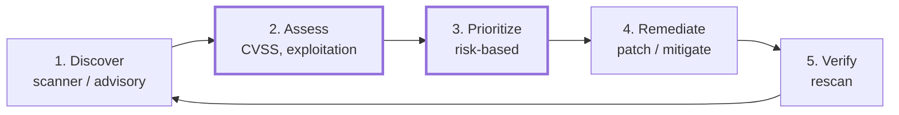
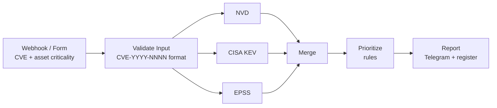

# Vulnerability Prioritization with n8n

> 🚧 **Work in progress.** This repository describes the design of the workflow. Implementation is under way; the status section below shows what is done.

An n8n workflow that takes a CVE ID (and optionally the criticality of the affected asset), enriches it from three public sources and returns a **risk-based priority and a remediation deadline**.

The goal is to show why **CVSS alone is not a priority**: a CVSS 9.8 vulnerability that nobody exploits can be less urgent than a CVSS 7.5 vulnerability that is already used in real attacks.

---

## Where it fits in the vulnerability management lifecycle

This workflow automates **steps 2 and 3**: it turns a raw CVE into a decision about *how fast* it has to be fixed.

## Data sources

| Source | What it answers | Auth |
|--------|-----------------|------|
| [NVD](https://nvd.nist.gov/developers/vulnerabilities) | What is it and how severe in theory? (description, CVSS score and vector, affected products) | optional API key (higher rate limit) |
| [CISA KEV](https://www.cisa.gov/known-exploited-vulnerabilities-catalog) | Is it **already exploited** in the wild? | none |
| [FIRST EPSS](https://www.first.org/epss/) | How **likely** is exploitation in the next 30 days? | none |

## Planned architecture

## Prioritization logic (draft)

| Condition | Priority | Target remediation |
|-----------|----------|--------------------|
| In CISA KEV | **Critical** | days |
| High EPSS **and** high CVSS | **High** | ~2 weeks |
| High CVSS, low EPSS | **Medium** | ~1 month |
| Low CVSS, low EPSS | **Low** | next regular cycle |

Asset criticality (e.g. internet-facing, holds customer data) raises the priority by one level. Thresholds and deadlines are placeholders and will be tuned; in a real organisation they come from the internal vulnerability management policy.

**Missing data is not "low risk":** if a source does not answer, the result is marked as incomplete instead of being downgraded.

## Status

- [x] Design and data sources
- [ ] Input validation (CVE format)
- [ ] NVD, CISA KEV and EPSS requests with error handling
- [ ] Prioritization rules
- [ ] Report to Telegram and review register
- [ ] Batch mode: a list of CVEs from a scan, processed with rate limiting
- [ ] Daily digest of new KEV entries relevant to a technology list
- [ ] Tests, screenshots, sanitised workflow export

## Design principles (same as my other projects)

- Input from outside is untrusted and validated before any request.
- API failures do not stop the workflow; they are reported.
- Secrets only in n8n Credentials, never in the exported JSON.
- Public data only.

## Related projects

- [n8n-ip-enrichment](https://github.com/dicybersec04/n8n-ip-enrichment): IP reputation enrichment (AbuseIPDB + VirusTotal)
- [n8n-vendor-softcheck](https://github.com/dicybersec04/n8n-vendor-softcheck): preliminary security review of SaaS / AI vendors
